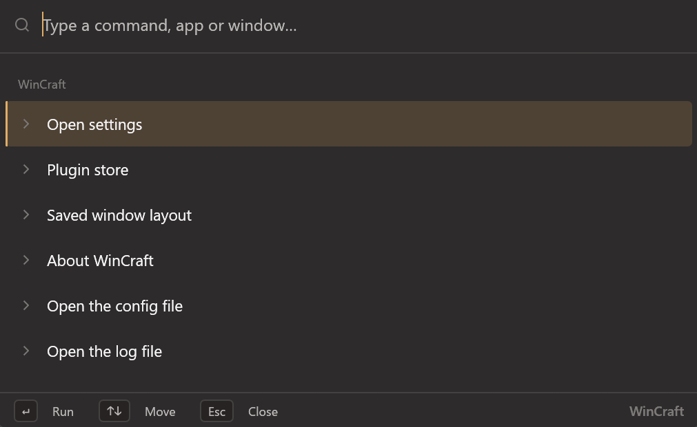

# WinCraft

### Windows 11, Crafted for Power Users.
**One tiny Rust binary. Eight essential desktop utilities. Zero background bloat.**

Stop running half a dozen background utilities that fight over keyboard hooks, eat RAM, and clutter your system tray. **WinCraft** is a native, modular Windows 11 tray suite that brings an instant command palette, multi-monitor layout recovery, visual window switching, and hardware display controls into a single executable.

[**Download Latest `wincraft.exe`**](https://github.com/OliverD25/wincraft/releases/latest) · [**Live Preview & Screenshots (wincraft.luminart.app)**](https://wincraft.luminart.app)



---

### Why Power Users Choose WinCraft
* **Zero-Friction Setup:** No installer wizards, no MSI bloat, no admin rights required. Download `wincraft.exe` and run it portably, or run `wincraft.exe --install` once to register it cleanly in your Start Menu and startup tasks.
* **Unified Host Architecture:** One lightweight process owns the tray icon, the autostart entry, global hotkeys (including multi-key chords like `Win+Alt+K, S`), the command palette, and the settings UI.
* **Eight Built-In Power Plugins:** Ships with **ScreenDimmer**, **ShortcutDetector**, **LayoutKeeper**, **WindowDeck**, **LanguageIndicator**, **WindowNamer**, **QuickJump**, and **QuickActions** out of the box.
* **1-Trait Extensibility:** Features are written as plugins that plug into a single Rust trait, so adding a new tool in an afternoon never means touching Win32 plumbing or writing UI code.
* **100% Local, One File per Plugin:** No telemetry, no accounts, and a separate JSON config file per plugin, so a bad edit costs one plugin, never your whole setup.

---

## Quick Start & Installation

### 1. Run Immediately (Portable)
Download `wincraft.exe` from the [latest release](https://github.com/OliverD25/wincraft/releases/latest) and launch it. There is no installer and nothing to unpack. It is a single file that writes its settings to `%LOCALAPPDATA%\WinCraft`.

> **Note:** The release includes `SHA256SUMS.txt` so you can verify your download. WinCraft is not code-signed yet, so Windows SmartScreen will ask once before the first start (see [Code signing policy](#code-signing-policy) and [Privacy](#privacy)).

### 2. One-Command System Install (Optional)
Want WinCraft in your Start Menu and starting automatically with Windows? Run this once from a normal terminal (not one started inside a sandboxed app like Claude Desktop, whose file redirection would hide the copy):

```powershell
wincraft.exe --install
```

* Copies the executable to `%LOCALAPPDATA%\Programs\WinCraft\wincraft.exe` and cleanly closes any running instance.
* Adds WinCraft to the **Start menu**, points the **"Start with Windows"** logon task at the new copy, and starts it.
* Leaves your settings right where they are, prints each step, and logs them to `%LOCALAPPDATA%\WinCraft\install.log` (safe to run again anytime).
* Run `wincraft.exe --uninstall` anytime to remove the shortcut and logon task while keeping the program and your settings intact.

### 3. Build from Source

Need to build it yourself? You only need `rustup` and the Windows SDK (for `rc.exe`, which compiles the icon into the executable). The Rust version is pinned by `rust-toolchain.toml`, so Cargo fetches the right compiler on first use:

```powershell
git clone https://github.com/OliverD25/wincraft; cd wincraft; cargo build --release
```

The result is `target\release\wincraft.exe`.

---

## What You Get at a Glance

* **Command Palette (`Win+Alt+P`)** — Opens a search box on the monitor your pointer is on. Type a few letters and press `Enter`. It finds WinCraft's commands, apps (Start menu, Store, and installed), open windows, files and folders across every disk (via *Everything*), and your bookmarks. It calculates sums as you type, and with a quick prefix it browses folders, runs terminal commands, asks an AI website, or searches the web. Beside the list, a live **inspector** shows what the selected row is and every action it can take. See [Command palette](#command-palette-winaltp).
* **QuickActions** — Windows 11 settings switches and everyday system fixes in the palette: type `dark`, `mic` or `caffeine` and press `Enter`, with a live on/off state and **Undo**. See [QuickActions](#8-quickactions).
* **Settings Window** — Clean navigation across *General*, *Themes*, *Plugins*, *Hotkeys*, *Layout*, *Bookmarks*, *Plugin Store*, and *About*, plus a dedicated page per plugin with its options, hotkeys, config file, and README.
* **Single & Chord Hotkeys** — Every command the palette lists can be bound to a single key press or two presses in a row (a chord, such as `Win+Alt+K`, then `S`). See [Hotkeys](#global-hotkeys--chords).
* **5 Native Themes with Live Hover Preview** — *Classic* (default), *Fluent*, *Terminal*, *Paper*, and *High contrast*, each in Dark, Light, or System mode. In *Fluent*, the palette uses Windows 11 glass (automatically turning solid on battery saver or when transparency effects are off). Point at any tile in **Settings → Themes** and every open WinCraft window previews that theme live; click to keep it. Automatically switches to *High contrast* when Windows high contrast is enabled.
* **Plugin Store** — Browse what exists, what your copy has, and what needs a newer WinCraft. Search tiles with `Ctrl+F`, filter by category, navigate with arrow keys, press `Enter` to open, and hit `Space` on the Plugins page to toggle a plugin on or off.
* **Minimal Tray Icon** — Open the palette, open settings, trigger one main action per enabled plugin, or quit. Everything else stays neatly inside the settings window.

---

## Self-Healing Updates

WinCraft checks GitHub for a newer release every hour, about 30 seconds after the PC wakes from sleep, and when you open the palette after 15 quiet minutes (and **About → Check for updates** checks immediately). A check that the palette starts shows its answer the next time you open the palette, so the list never changes while you look at it. When a new version arrives, you get a single tray notification, an **"Update to …"** item in the tray menu, full release notes in the Updates block at the top of the About page, and an **"Update ready"** row at the top of the palette when nothing is typed. That row is not selected, so `Enter` still opens your top recent item; `↑` selects it, `Enter` updates, `Ctrl+O` opens the release page, and `Ctrl+Del` hides it until the next version (typing **Update WinCraft** still finds it). Nothing changes until you click **Update now** or run the palette command **Update WinCraft**.

1. **Verified Download:** Downloads `wincraft.exe` and `SHA256SUMS.txt` from the release, verifies the checksum, swaps the executable in place, and restarts WinCraft. A 2-step progress bar in the Updates block shows how far it is. While it downloads, **Cancel** stops it, deletes the partial file, and keeps the version you have.
2. **Automatic 30-Second Rollback:** If the new version does not run for 30 seconds without crashing, WinCraft ends it, restores your previous executable, restarts the old version, and tells you: *"Update to … failed, kept …"*.
3. **Downloaded Ahead:** With **"Download updates ahead"** on (the default, on the About page), a new version is downloaded and checked in the background as soon as the check finds it, so **Update now** takes a few seconds. It never installs on its own, never downloads on a metered connection, and the kept file (`wincraft.staged.exe` next to `wincraft.exe`) is deleted when a newer one replaces it, after the update, or when you switch the setting off.
4. **You See It Happen:** While an update you started runs, a small WinCraft panel at the bottom right of the screen shows each step: checking, downloading with a percent, checking the download, restarting. If it fails, the panel says why and that your version stays. It never takes the keyboard; a click opens About. An update you ask for installs a version WinCraft already knows of (or already downloaded) at once, without asking GitHub again.
5. **GitHub's Limit Is Not "Offline":** GitHub allows 60 update-API requests an hour per internet address, shared by every program and PC behind the same router. WinCraft sends at most 6 of them an hour. When GitHub says the limit is reached, WinCraft reads the newest version from the releases page instead, which that limit does not cover; the checksum check stays the same. If that fails too, it says how many minutes GitHub limits checks, and the automatic checks wait that long.
6. **Full Control:** Only an `--install`ed copy updates itself (portable copies ask you to run `--install` first). Toggle **"Check for updates automatically"** on the About page anytime.

---

## The Eight Built-In Plugins

### 1. ScreenDimmer

Covers any monitor with a click-through black overlay (which turns partly see-through under your pointer) or powers it off over **DDC/CI** like its physical power button, **without Windows moving your open windows**. Monitors that ignore standby are dimmed to brightness `0` instead, and monitors without DDC/CI are covered. Configure what `Shift` does per monitor (*Auto*, *Off*, *Dim*, *Cover*) on the plugin's page. Your mouse pointer cannot get lost on a monitor that is off, and quitting WinCraft brings every monitor right back. Monitors are counted from the left. [Full README](src/plugins/screen_dimmer/README.md)

| Hotkey | What it does |
| --- | --- |
| `Win+Alt+F1 / F2 / F3` | Cover / uncover the left / centre / right monitor |
| `Win+Alt+Shift+F1 / F2 / F3` | Turn off / bring back the left / centre / right monitor |
| `Win+Alt+F12` | Bring back every monitor |

### 2. LayoutKeeper

Remembers which virtual desktop and which monitor each window belongs on, the exact order of thumbnails in its taskbar group, and which window is in front, and puts everything back after a reboot. Unplugged monitors are respected (their windows stay put). Works with any app (Chrome, Claude, Telegram, anything with a window), with a *Never touch* setting for exceptions. While restoring after a reboot, a small panel asks you to wait. The **Layout** page lists every saved window with its desktop (which you can edit) and recent activity, flagging same-app windows that share an identical title. [Full README](src/plugins/layout_keeper/README.md)

| Hotkey | What it does |
| --- | --- |
| `Win+Alt+L` | Restore the saved layout |
| `Win+Alt+J` | Save the layout now |
| `Win+Alt+[` | Move the front window one place left in its taskbar group |
| `Win+Alt+]` | Move the front window one place right in its taskbar group |

> **Technical Note:** Moving windows between desktops uses undocumented Windows interfaces ported from MScholtes' *VirtualDesktop* (MIT). Because they can change between Windows builds, LayoutKeeper safely disables desktop moves for the session if they do not respond as expected and notes this on its page. To reorder with the mouse, use **WindowDeck** (dragging inside Explorer's native thumbnail flyout is blocked from outside processes on Windows 11 24H2). The Windhawk mod "Taskbar Thumbnail Reorder" still works for hand reorders, but WinCraft cannot see its changes, and the next restore replaces them.

### 3. WindowDeck

Shows all windows of an app in a row above the taskbar with a live picture of each, laid out by monitor like your desk (press `D` or click the link to view other desktops). Pick, move, and close windows from the keyboard, or drag them into order, to another desktop, or to another monitor. When **LayoutKeeper** is enabled, the order you set is saved with your layout. *(Formerly LayoutKeeper's "Arrange strip" before v0.20.25; existing settings and hotkeys migrate automatically.)* [Full README](src/plugins/window_deck/README.md)

| Hotkey | What it does |
| --- | --- |
| `Win+Alt+A` | Wait 3 seconds for a taskbar number and open WindowDeck for that button; press `Win+Alt+A` again for the app in front. If no number comes within 0.7 s, numbers appear over each taskbar button. |

* **Inside WindowDeck:** Press `1–9` (`0` for 10) to open that window card, or `Ctrl+Number` to switch WindowDeck to another taskbar button. `Ctrl+W` closes the picked window, `Ctrl+N` opens a new window of the app, `F2` renames it (with WindowNamer on), and `Ctrl+H` hides or shows the key hints.
* **Optional `Win+1…9` Override:** Enable in WindowDeck settings to open WindowDeck with `Win+Number` for any running taskbar slot (pressing the number again while holding `Win` cycles windows). Pinned apps that aren't running launch normally, and `Win+Shift/Ctrl/Alt+Number` stay with Windows.
* **Optional Taskbar Preview Replacement:** Enable in settings, the tray menu, or the palette to show WindowDeck instead of Windows' native thumbnail preview after hovering for `0.15 s` (configurable from `0.05` to `1.5 s`) on any app with 2+ windows.

### 4. QuickJump

Pins up to ten windows to digits `0–9`, like **Harpoon in Neovim**, so you can jump back to any of them from anywhere, across any virtual desktop. While waiting for a digit, a strip at the bottom of the screen displays all ten slots. Jumping switches virtual desktops automatically and restores minimized windows without moving them. Pins find their window again by app and title even after a restart (and launch the app if closed). Every change shows a notice with **Undo**, and the pin list lets you view live thumbnails, reorder, rename, and tune pins. [Full README](src/plugins/quick_jump/README.md)

| Hotkey | What it does |
| --- | --- |
| `Win+Alt+Q`, then a digit | Jump to the window in that slot |
| `Win+Alt+Shift+Q`, then a digit | Pin the window in front to that slot |
| `Win+Alt+Q` twice | Open the pin list |

### 5. WindowNamer

Give any window a persistent custom name: turn three identical browser windows into *"Mail"*, *"Research"*, and *"Bank"* instead of three page titles. The taskbar thumbnail, `Alt+Tab`, and the title bar all show your custom name, and it stays put when the app changes its title or restarts. Rename via hotkey or from a card in **WindowDeck** (`Clear all names` in the palette resets everything). Works seamlessly alongside **LayoutKeeper**. [Full README](src/plugins/window_namer/README.md)

| Hotkey | What it does |
| --- | --- |
| `Win+Alt+E` | Rename the active window (opens the palette with the current name selected; `Enter` saves, `Enter` on an empty box clears) |

### 6. ShortcutDetector

Shows which global key combinations are already taken on your PC and lets you test any combination by pressing it before you assign it. [Full README](src/plugins/shortcut_detector/README.md)

| Hotkey | What it does |
| --- | --- |
| `Win+Alt+S` | Open the shortcut detector |

*(Note: No outside program can see programs that read keys through low-level keyboard hooks, like AutoHotkey scripts, short of injecting code into every running process, and the window clearly states this.)*

### 7. LanguageIndicator

Shows which input language you switched to right in the center of the screen, macOS-style: switch from Ukrainian to English and a translucent panel displays `UK → EN` with `"English (United States) · US"` underneath, then fades out smoothly. It never steals focus and lets clicks straight through. Trigger it on demand via the palette command **Show current input language**. [Full README](src/plugins/language_indicator/README.md)

### 8. QuickActions

Puts Windows 11 settings switches and everyday system fixes straight into the command palette, so you never have to dig three menus deep into Settings. Open the palette, type a few letters (such as `dark`, `mic` or `caffeine`), and press `Enter`. For switches, the palette stays open so you can flip the next one right away, and every change shows a short notice with **Undo**. [Full README](src/plugins/quick_actions/README.md)

Each switch reads the real state from Windows every time the palette opens and shows it with a coloured tile and a toggle (`"Microphone is muted"`, `"Hidden files are shown"`, `"PC stays awake"`). Actions are named `Area: Verb` (so `window` lists every window action and `explorer` lists File Explorer switches), and everyday words work too (`night` finds dark mode, `caffeine` finds keep awake, `pin` finds always on top). Nothing runs in the background; press `Ctrl+K` on any action in the palette to give it a hotkey or a chord of its own.

| What is inside | Actions |
| :--- | :--- |
| **Switches** | Dark Mode · File Extensions · Hidden Files · Desktop Icons · Taskbar Auto-Hide · Microphone Mute · Keep Awake · Always on Top |
| **One-step commands** | Switch audio output · Free a busy port · Convert the clipboard to plain text · Safely remove a USB drive · Center a window · Flush DNS · Empty the Recycle Bin |

Actions that end in `…`, and Kill Process on Port, Switch Output Device and Eject USB Drive, show a list in the palette: type to filter, `Enter` picks, `Esc` goes back.

While an action is selected, the palette's inspector shows its live state and what `Enter` will do: *Now: Dark · Enter switches to Light*, the window's current and new size, how long keep awake has been on, the addresses Copy Local IP would copy, the UUID it will copy, or what the Recycle Bin holds.

---

## Command Palette (`Win+Alt+P`)

The palette combines a fast search list with a live **inspector** beside it. As you move the cursor, the inspector shows a live picture of the selected window, full metadata, where the row comes from, and every available action with its shortcut (`→` moves into the actions, `↑`/`↓` picks one, `Enter` runs it, `←` or `Esc` goes back; on monitors narrower than 1100 px, `→` opens the inspector as an overlay).

* **Zero-Query Suggestions:** With nothing typed, you immediately see **Recent and suggested**: up to five open windows and frequently used apps. Use `Ctrl+,` (or the footer gear icon) for Settings and `Ctrl+P` for Plugins.
* **Move It Where You Want:** Press and hold on any blank part of the palette (the header around the search box, the search box right of what you typed, the empty part of the list, the footer) and drag to move it. The palette opens there next time, on that monitor, and remembers it after a restart. Double-click blank space, or run the palette command **Palette: Move back to the centre**, to put it back.
* **5-Way Blended Search:** Without a prefix, the palette searches WinCraft commands, apps (Start menu shortcuts, Store apps, and installed programs, listed once each and skipping uninstallers and updaters), open windows across all virtual desktops, bookmarks, and files and folders via *Everything*.
* **Prefix Filtering:** Type a symbol at the start (or `w ` for windows, `a ` for all apps A–Z) to turn it into a filter chip (`Backspace` in the empty box removes it):

| Prefix | What it searches | `Enter` | `Shift+Enter` | `Tab` |
| --- | --- | --- | --- | --- |
| *(none)* | Commands, apps, open windows, bookmarks, files | Run, open, or switch to | — | Put the title in the box; on a File Explorer window, browse its folder under `/` |
| `<` | Open windows only (the `Alt+Tab` list) by title, app, or custom WindowNamer name | Switch to it (restoring if minimized) | — | Put the title in the box; on a File Explorer window, browse its folder under `/` |
| `/` | Drives, then folder by folder (`/C:\Users\`). Typing after the folder also searches the folders below it (nearest first) | Open the file or folder | Show in Explorer, selected | Go into the folder |
| `.` | Files and folders on every disk via *Everything* (or the Windows index as a fallback): `.pswds` | Open it | Show in Explorer, selected (`Ctrl+Enter` copies the path) | Go into the folder under `/` |
| `'` | Your bookmarks (all of them when nothing is typed) | Open it | Show in Explorer, selected (`Ctrl+Enter` copies the target) | Go into the folder under `/` |
| `=` | Calculator (`+ - * / ^ %`, brackets, `×`, `÷`, `,` as the decimal mark). Finished sums like `12*3` are also answered without `=` | Copy the answer (`Ctrl+C` copies the sum with it; `Ctrl+Enter` pastes the answer into the window you were in) | — | Put the answer in the box |
| `>` | A command for your chosen shell (WSL bash by default), then your earlier commands | Run it with no window and stream the output into the palette | — | Put the earlier command in the box |
| `!` | WinCraft's own commands, plugin actions, and on/off switches | Run it | — | Put the command's name in the box |
| `?` | Alone: the list of prefixes. With words: **Ask AI**, then web search (or click the *Ask AI* pill) | Pick the prefix, or open the chosen AI site with your question (`Ctrl+Enter` searches the web) | — | Pick the prefix |

In the calculator, `%` after a number is a percentage (`200 * 15%` is `30`) and between two numbers is the remainder (`10 % 3` is `1`).

### Smart Ranking & Intent Memory

* **Frequency Decay:** Every time you run an app, command, window, file, or folder with `Enter`, it gains a point that halves every 14 days, promoting your favorites when matches are otherwise equal. A clearly better match stays ahead, and a result named exactly what you typed stays first.
* **Typed-Text Memory:** WinCraft remembers what you typed before picking a result. Type the same text again and that result jumps to the top under **Best match** (*"often picked"*). The inspector shows how many times you picked it this month; press `Ctrl+Delete` (*Forget this pick*) to reset a specific association, or toggle **Learn from my picks** in **Settings → General**. The counts live in `palette_usage.json`.

### Batch Window Management in the Palette

On any window row: `Enter` switches to it, `Shift+→` moves it to the next monitor, `Ctrl+Enter` opens it in **WindowDeck**, and `Ctrl+W` asks it to close, the way its own close button does. The inspector displays the program and process ID, monitor, virtual desktop, RAM usage, and a **Show on all desktops** toggle. Mark multiple windows with `Ctrl+Space`, `Shift+Click`, or `Ctrl+A` to batch-arrange in WindowDeck, move monitors, minimize (`Ctrl+M`), or close all marked windows at once. `Esc` clears the marks before it closes the palette.

### Private "Ask AI" Integration

**Ask AI** opens your chosen website (**Settings → General → Ask AI site**: Claude by default, or ChatGPT, Perplexity, Copilot, or a custom URL) in your default browser with your prompt pre-filled. WinCraft sends nothing over the network itself and requires no API keys or accounts. When a palette search matches nothing, press `Enter` to ask AI or `Ctrl+Enter` to search the web.

### Instant File Search with *Everything*

WinCraft queries **Everything** (voidtools, free, v1.4+) on a background thread 120 ms after you stop typing, returning results in milliseconds without ever freezing the UI. Everything's own search words work too, like `ext:pdf invoice` or `*.log`. If Everything isn't running, WinCraft falls back to the **Windows Search index**: slower (the palette waits up to 0.8 s), limited to what Windows has indexed (your user folders by default), and without Everything's search words. Rows from the index say "Windows index". Both can be switched off in **Settings → General**.

### Quick Bookmarks (`'`)

Press `Ctrl+B` on any file, folder, or `?` web address in the palette (or run `Add bookmark…`) to assign a short keyword phrase. Typing that phrase puts your bookmark at the very top of the palette. Manage all entries in `bookmarks.json` or the **Bookmarks** settings page, and remove any bookmark by pressing `Ctrl+Delete` twice within 5 seconds.

### Headless Terminal (`>`)

Run commands in **WSL bash**, **PowerShell 7**, **Windows PowerShell**, **Command Prompt**, or a custom shell without opening a console window. Typing never runs anything; `Enter` does. Output streams live into the palette with execution timing (`Running… 1.2 s` → `Exit 0 · 3.4 s`).

* Press `Esc` once to stop a running command and everything it started, or close the palette and type `>` later to see the output of a command that kept running.
* `Enter` copies a single output line; `Ctrl+Shift+C` copies the full output; `Ctrl+Enter` opens the command in a new **Windows Terminal** tab that stays open (or a console window when Windows Terminal is not installed).
* **Directory-Aware:** If you just browsed into a folder with `/`, the command runs right inside that folder.
* **Destructive Command Guard:** Dangerous commands (`rm -rf`, `mkfs`, `dd of=`, `shutdown`, `git push --force`, `git reset --hard`, `format`, `diskpart`, `Remove-Item -Recurse`, `del /s`, etc.) require a second `Enter` within 5 seconds to run.
* The last 100 commands are kept in `terminal_history.json`, on this PC only, unless you switch that off.

---

## Global Hotkeys & Chords

**Settings → Hotkeys** lists every palette command grouped by plugin, with live status indicators:

* 🟢 **Green dot:** Working normally.
* ⚠️ **Warning triangle:** Held by another app or another WinCraft command.
* ⚪ **Grey dot:** Plugin is currently disabled.

Click any row (or press `Ctrl+K` on a command in the palette) to record a shortcut:

* **Single Press or 2-Step Chords:** Use `Win`, `Ctrl`, or `Alt` (optionally with `Shift`) with any key, or `F13–F24` alone. Press a second key within 3 seconds to create a chord like `Win+Alt+K, S`; while WinCraft waits for the second key, a small line at the bottom of your screen says so.
* **Conflict Protection:** Keys Windows keeps (`Win+L`, `Ctrl+Alt+Delete`, `Alt+Tab`, etc.) and shortcuts owned by other apps are refused before saving, while a key another WinCraft command has offers a one-click **Move here** reassignment. `Enter` saves, `Esc` cancels, `Backspace` clears; `Backspace` again removes the hotkey.

### Hotkey format

In the config files, modifiers are joined to one key with `+`, in any case:

- Modifiers: `Ctrl` (or `Control`), `Alt`, `Shift`, `Win`
- Keys: `A`–`Z`, `0`–`9`, `F1`–`F24`, `Space`, `Esc`, `Tab`, `Enter`,
  `Backspace`, `Insert`, `Delete`, `Home`, `End`, `PageUp`, `PageDown`, `Left`,
  `Right`, `Up`, `Down`, `PrintScreen`, `Pause`, `ScrollLock`, `NumLock`,
  `Numpad0`–`Numpad9`, `NumpadPlus`, `NumpadMinus`, `NumpadMultiply`,
  `NumpadDivide`, `NumpadDecimal`, and the punctuation keys `;` `=` `,` `-` `.`
  `/` `` ` `` `[` `\` `]` `'`

Two presses joined by `, ` make a chord: `Win+Alt+K, S` or `Win+Alt+K, Win+Alt+S`.

A bare key without modifiers is accepted in the file too, such as `F13` or `Pause`. Keep it to keys you never type with, because WinCraft takes that key from every other program while it runs. If another program already owns a combination, WinCraft keeps running, shows a tray notification and marks the hotkey "taken by another app" on the plugin's page and on the Hotkeys page.

---

## Clean, Safe Configuration

Everything lives in human-readable JSON under `%LOCALAPPDATA%\WinCraft` (`C:\Users\<you>\AppData\Local\WinCraft`):

```text
config.json                         the host's own settings
palette_usage.json                  how often each palette result was picked
bookmarks.json                      your palette bookmarks
plugins\
  screen_dimmer.json                one file per plugin
  shortcut_detector.json
  layout_keeper.json
  window_deck.json
  language_indicator.json
  window_namer.json
  quick_jump.json
  layout_keeper.state.json          the saved window layout, written by LayoutKeeper
  window_namer.names.json           the saved window names, written by WindowNamer
  quick_jump.state.json             the pinned windows, written by QuickJump
  layout_keeper.state.prev.json     the layout from before a browser crash or restart
  layout_keeper.state.shutdown.json the layout at the last shutdown or quit
cache\                              the last plugin index fetched from GitHub
wincraft.log                        what the program did in this run; an update adds to it
wincraft.prev.log                   the log of the run before, kept at each new start
install.log                         what the last --install or --uninstall did
detailed\                           the detailed log, only while you have it on (see below)
  detailed-<date>.log               up to 100 MB each, at most 5 files kept
  reports\                          the reports saved with "Detailed log: Save a report"
```

Splitting the files this way means resetting one plugin deletes one file, and a broken manual edit costs one plugin rather than your whole configuration. If WinCraft cannot read a file, it leaves your file untouched, runs on defaults, logs the reason, and never overwrites your work until you fix it.

### `config.json`

```json
{
  "start_with_windows": false,
  "theme": "classic",
  "mode": "system",
  "palette_hotkey": "Win+Alt+P",
  "search": {
    "prefixes": { "bookmarks": "'", "calc": "=", "commands": "!", "files": ".", "paths": "/", "terminal": ">", "web": "?", "windows": "<" },
    "web_url": "https://www.google.com/search?q={query}",
    "terminal_shell": "WSL bash",
    "terminal_custom": "",
    "terminal_history": true,
    "rank_by_use": true,
    "everything": true,
    "file_search_fallback": true
  },
  "updates": {
    "check_daily": true,
    "last_check": 1792260953,
    "latest": "v0.16.0",
    "download_ahead": true,
    "hidden_version": ""
  },
  "tips": {
    "show": true,
    "state": { "bookmark-ctrl-b": { "shown": 2, "done": false } }
  }
}
```

| Key | Meaning |
| --- | --- |
| `start_with_windows` | Mirrors the "Start with Windows" switch. Creates a user-level logon task in Task Scheduler (5 s delay, no admin rights needed; falls back to `HKCU\...\Run` if Task Scheduler refuses). Remove it by hand anytime with `schtasks /Delete /TN WinCraft /F`. |
| `theme` | `classic`, `fluent`, `terminal`, `paper`, or `high-contrast`. |
| `mode` | `system`, `light`, or `dark`. |
| `palette_hotkey` | Shortcut that opens the command palette. |
| `shortcuts` | Shortcuts assigned to palette commands that have no plugin hotkey of their own, by command ID (e.g. `"wincraft.open-settings": "Win+Alt+K, O"`). |
| `search.prefixes` | Symbol prefix for each palette search source (`""` disables a prefix; restart WinCraft after changing). |
| `search.web_url` | Web search URL with a `{query}` placeholder (`https://` or `http://`). |
| `search.terminal_shell` | Shell for `>`: `WSL bash`, `PowerShell 7`, `Windows PowerShell`, `Command Prompt`, or `Custom`. |
| `search.terminal_custom` | Custom command line with `{cmd}` and optional `{cwd}` (e.g. `C:\msys64\usr\bin\bash.exe -lc {cmd}`). |
| `search.terminal_history` | Whether commands run from the palette are remembered in `terminal_history.json` (last 100). |
| `search.rank_by_use` | *Learn from my picks*: whether frequently picked results and typed queries move up. |
| `search.ask_ai_site` | Website *Ask AI* opens: `Claude`, `ChatGPT`, `Perplexity`, `Copilot`, or `Custom URL`. |
| `search.ask_ai_custom` | Custom URL with a `{query}` placeholder. |
| `search.everything` | Whether files and folders are searched in the blended list and after `.`. |
| `search.file_search_fallback` | Whether the Windows Search index answers file searches when Everything is not running. |
| `updates.check_daily` | Whether GitHub is asked on its own for a newer release: every hour, after a wake, and when the palette opens (the key keeps its old name). |
| `updates.last_check` / `latest` | Time and tag of the last update check (written by WinCraft). |
| `updates.download_ahead` | Mirrors "Download updates ahead": a new version is downloaded and checked in the background, never installed on its own. |
| `updates.hidden_version` | The release hidden from the palette's "Update ready" row with `Ctrl+Del`; a newer release shows again. |
| `tips.show` / `tips.state` | Controls the in-app tips (`"Show all tips again"` on General resets the state). |
| `detailed_log` | Mirrors the "Detailed log" switch (off by default). It stays on after a restart and an update until you turn it off. |

### Detailed log

When a bug is hard to catch, turn on the **Detailed log**: in the palette (the **Detailed log** switch row; Enter flips it and the palette stays open), on **Settings → General**, or with the tray menu's *Detailed log* item. It has no hotkey. While it is on, WinCraft records everything it does in `%LOCALAPPDATA%\WinCraft\detailed\`: every key its keyboard hooks see and what they decided, the Windows and digit keys while a Windows key is down, every change of the window in front, how long each step took, and what WindowDeck and the palette did. It also mirrors everything from `wincraft.log`, with the debug lines.

You always see that it is on: WinCraft shows a notice when it turns on or off and at every start while it is on, the tray tooltip reads *WinCraft · detailed log on*, and the palette footer shows a small **LOG** tag.

- **Detailed log: Mark this moment** asks for a few words and writes them with the time. Use it right after a bug happens, so the reader knows where to look.
- **Detailed log: Save a report** copies the newest detailed log, `wincraft.log`, the log before it, `config.json` and the session header into one dated folder under `detailed
eports\`, and opens it, so you can hand it over.
- **Detailed log: Delete the files** deletes every detailed log file and saved report (press `Enter` twice).

`tools\detailed-log.ps1 <file>` in the repository sums a detailed log up on one page: the session header, your marks, each press of a Windows key with the hook lines next to the key states Windows saw (a digit Windows saw that no WinCraft hook line names is marked), the busy moments, and the window-in-front changes.

The detailed log only reads: it never moves a window, presses a key or changes a setting.

### `plugins/<id>.json`

```json
{
  "enabled": true,
  "hotkeys": { "toggle_monitor_1": "Win+Alt+F1" },
  "settings": { "idle_opacity": 1.0, "hover_opacity": 0.7 }
}
```

WinCraft fills in every missing key on startup: start it once, then open the file and edit values without ever guessing key names.

---

## Command-Line Interface

| Option | What it does |
| --- | --- |
| `--open-palette` | Opens the command palette at startup. |
| `--open-arrange` | Opens WindowDeck at startup. |
| `--open-settings` | Opens the settings window at startup. |
| `--open-detector` | Opens the ShortcutDetector window at startup. |
| `--quit` | Asks the running WinCraft to shut down cleanly and waits up to 10 s (exit codes: `0` closed, `1` none running, `2` still running). |
| `--install` | Copies this exe to `%LOCALAPPDATA%\Programs\WinCraft`, adds the Start menu shortcut, points the logon task at it, and starts it (`0` done, `1` failed, `2` refused inside another app's package). |
| `--uninstall` | Closes WinCraft and removes the shortcut and logon task while keeping the program and settings. |
| `--restarted` / `--updated-from <v>` / `--update-failed <v>` | Used by Windows and WinCraft's self-updater across restarts and rollbacks. |
| `--write-plugin-index` | Regenerates `plugins.json` (for contributors). |

*(Tip: Turn on the [Detailed log](#detailed-log) or set `WINCRAFT_DEBUG=1` for more detail in the log, or `WINCRAFT_INSTANCE=<suffix>` to run a separate test instance with its own `WinCraft.<suffix>` logon task.)*

---

## Contributing

WinCraft is open source, and contributions are welcome. Its goal and guiding principles live in [CONSTITUTION.md](CONSTITUTION.md); the second principle is that **anyone should be able to add a useful feature in an afternoon**.

* **New here?** Pick an issue labelled [`good first issue`](https://github.com/OliverD25/wincraft/labels/good%20first%20issue).
* **Have an idea or found a bug?** [Open an issue](https://github.com/OliverD25/wincraft/issues/new/choose); the form asks only what is needed.
* **Writing a plugin?** See [CONTRIBUTING.md](CONTRIBUTING.md). A plugin is one folder, one trait implementation, a README, and one line in the plugin list. You describe your settings; WinCraft draws and saves them.

Everyone follows the [Code of Conduct](CODE_OF_CONDUCT.md).

---

## Privacy & Security

### Privacy

WinCraft sends nothing about you anywhere: **no telemetry, no account, no analytics**. It touches the network only in these four cases:

1. **Update check:** Asks `api.github.com/repos/OliverD25/wincraft` for the latest release, at most every hour and after a wake or a palette opening that comes 15 minutes after the last check, and never more than 6 times an hour (can be switched off in **Settings → About**). When GitHub's API is limiting requests, it asks `github.com/OliverD25/wincraft/releases/latest` instead and reads only where it redirects.
2. **Update now and Download updates ahead:** Downloads `wincraft.exe` and `SHA256SUMS.txt` from this repository's releases when you start an update, or in the background as soon as a new release is found while **Download updates ahead** is on (the default; never on a metered connection, never installed without you).
3. **Plugin Store:** Reads the plugin list from this repository when you open the Plugin Store page.
4. **Search & Ask AI:** Opens your default browser at the search or AI site you chose, only when you press `Enter`.

Your settings, layouts and palette history stay in `%LOCALAPPDATA%\WinCraft` on your PC.

The **Detailed log** (off by default) records much more while you have it on: window titles, program names, the keys WinCraft's hooks see, and the text you type in the palette. It is written only to `%LOCALAPPDATA%\WinCraft\detailed\` on your PC and is never sent anywhere. **Detailed log: Delete the files** removes it.

### Code Signing Policy

Releases are not code-signed yet. WinCraft applied to the [SignPath Foundation](https://signpath.org/) for free code signing in October 2026; it was not accepted this time, because the project is still new, and it will apply again later. Until a release is signed, each release's `SHA256SUMS.txt` is the way to verify a download. The rules below are the ones signed releases will follow.

* Every release is built from a git tag by GitHub Actions ([release workflow](.github/workflows/release.yml)); nobody builds a release by hand.
* Only WinCraft's own code is signed. It contains no third-party binaries; all Rust crates are compiled from source in the same build.
* **Committers, reviewers, and approvers:** `OliverD25`.
* Changes from contributors are reviewed in a pull request before merging, and all team members use multi-factor authentication on GitHub and SignPath.

---

## Licence

**MIT.** See [LICENSE](LICENSE).

The interface uses *Segoe UI* and *Cascadia Mono* (or *Consolas*) from your own Windows installation; nothing of them is shipped. WinCraft bundles four fonts under the SIL Open Font License 1.1 (with licence files in [`assets/fonts`](assets/fonts)): *Selawik* by Microsoft (fallback when Segoe UI is missing), *JetBrains Mono* for paths and code, and *Lora* and *Cormorant* for the Paper theme.
